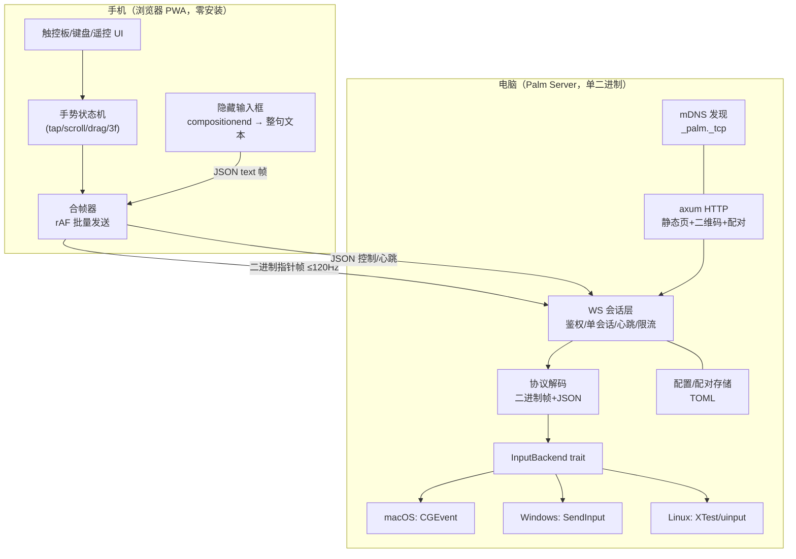

# Palm 设计文档 —— 把手机变成电脑的触控板

> PALM = **P**hone-**A**s-**L**aptop-**M**ouse。手机浏览器扫码即用，电脑端单二进制，macOS 优先。

- 调研依据：[RESEARCH.md](./RESEARCH.md)
- 状态：M0–M4 已实现（macOS 实测，Windows/Linux 交叉编译验证）；另有 Android/iOS 原生客户端（`clients/`，协议与本设计 §4 完全一致）。实现偏差见 README「状态」与代码注释。
- 本文所有决策均给出理由；替代方案在 §14 列出。

---

## 1. 目标与非目标

### 1.1 目标

| # | 目标 | 衡量标准 |
| --- | --- | --- |
| G1 | 手机浏览器扫码即用，不装 App | 从打开相机到能移动光标 ≤ 30s |
| G2 | 触控板手感对齐 MacBook | 单指移动无"顿挫感"，滚动带惯性，所有常用手势可用 |
| G3 | 中文键盘输入可用 | 手机 IME 整句上屏到电脑，含标点 |
| G4 | 局域网内默认安全 | 未经配对的设备无法控制；无云端依赖 |
| G5 | macOS 一等公民（用户日常环境），可扩展 Windows/Linux | 滚动方向/精度符合 mac 习惯 |
| G6 | 分发简单 | 电脑端单文件（macOS .app / 单二进制），无 Python/Node 运行时依赖 |

### 1.2 非目标（v1 不做）

- 跨公网远程控制（走 Tailscale 等组网工具即可覆盖，见 §11）
- 屏幕回显（Weylus/scrcpy 形态，重；进 backlog）
- 蓝牙 HID / USB 物理设备模拟（需原生 App，backlog）
- 游戏级低延迟输入（原始输入/独占模式不在范围内）

### 1.3 核心体验指标

- 移动指令端到端延迟（触点→光标动）：p50 ≤ 25ms，p95 ≤ 50ms
- 指针事件吞吐：支持 120Hz 触控上报不丢步
- WS 重连：锁屏/切后台恢复后 ≤ 1s 恢复控制

---

## 2. 总体架构



**核心分层原则**：网络上流动的是"语义事件"（移动增量/滚动增量/点击/文本），不是原始触摸点。手势判定 100% 在前端，服务端保持 dumb & fast，跨平台一致性由前端保证。

---

## 3. 技术选型

| 维度 | 选择 | 理由 | 备选 |
| --- | --- | --- | --- |
| 服务端语言 | **Rust** | 单二进制分发（G6）、延迟可控、Weylus 验证过该形态；enigo/core-graphics/windows 生态齐 | Python（AirMouse 路线，迭代快但要打包运行时）；Node（robotjs 失修） |
| HTTP/WS 框架 | axum + tokio | 主流、WS 支持好、tower 中间件做限流方便 | warp（Weylus 同款，维护趋缓） |
| 输入注入 | 平台自写后端（见 §8），enigo 仅作兜底 | enigo 抽象不掉滚动单位/Unicode/多屏的坑（调研结论 4） | pynput / robotjs |
| 手机端 | **Web PWA**，原生 TS + Vite，不引框架 | 触控板页面极简，框架无收益；PWA 可加到主屏、Wake Lock 防息屏 | hammer.js（阈值不可控，弃）；React（过重） |
| 传输 | WebSocket（TCP） | 现成、可靠、保序；局域网 RTT 2–8ms 足够 | WebRTC DataChannel（过重）；UDP（需自己造可靠层，backlog 再评估） |
| 发现 | mDNS（mdns-sd crate）+ 二维码 | 手机扫电脑二维码是主路径；mDNS 兜底 | 纯手输 IP |
| 配置 | TOML 文件 | 人类可读 | JSON |

**为什么手势放前端**（决策点）：服务端注入每次 CGEvent 调用约 0.5–2ms，若传原始触摸点，服务端要做定时器/插值，复杂且每平台重复；前端判定后网络流量从 ~240pkt/s 降到 ≤120pkt/s，且"两指滚动+惯性"这类逻辑只在 JS 写一次。

---

## 4. 协议设计

### 4.1 通道划分

一条 WS 连接，两种帧（利用 WS 原生 text/binary 区分，零开销）：

- **text 帧**：JSON，低频（控制、键、文本、心跳、配置）
- **binary 帧**：高频指针/滚动事件，固定布局

### 4.2 JSON 控制消息

```jsonc
// → 客户端发出
{"t":"hello","v":1,"ua":"ios-safari-17","w":390,"h":844,"dpr":3,"touch":true,"device_id":"uuid"}
                                     // device_id：客户端稳定的安装级标识，服务端按它给设备去重
{"t":"pair","mode":"open"}          // 免配对码直连（pairing.open，默认开；PIN 仍生效）
{"t":"pair","mode":"token"}          // 或 {"t":"pair","mode":"pin","pin":"4821"}
{"t":"key","k":"cmd","d":1}          // 修饰键/单键 按下(d=1)/抬起(d=0)
{"t":"tap","k":"enter"}              // 单击键（press+release），k: enter/esc/tab/space/f5/...
{"t":"combo","ks":["cmd","space"]}   // 组合键（按序按下再抬起）
{"t":"text","s":"你好，世界"}         // IME 整句注入
{"t":"backspace","n":3}              // 删除 n 个字符（配合输入法回改）
{"t":"media","k":"play"}             // play/pause/next/prev/volup/voldown/mute
{"t":"cfg","sens":1.2,"natural":true} // 同步设置（持久化到服务端）
{"t":"ping","ts":1699…}              // 心跳+RTT 测量，5s 一次

// ← 服务端返回
{"t":"welcome","server":"1.0.0","os":"macos","screens":[…],"state":"pending_pair"}
{"t":"pair_ok","name":"张三的 iPhone","cred":"…"}  /  {"t":"pair_err","e":"bad_pin"}
                                     // cred：长期设备凭证，客户端持久化后凭它免配重连
{"t":"pong","ts":…,"rtt":7}
{"t":"err","e":"rate_limited"}
```

### 4.3 二进制指针帧（little-endian）

| 帧类型 | 字节 | 布局 | 说明 |
| --- | --- | --- | --- |
| MOVE | `0x01` | `[i16 dx][i16 dy]` | 已含灵敏度/加速曲线的最终位移 |
| SCROLL | `0x02` | `[i16 dx][i16 dy]` | 像素增量（含惯性帧），服务端按平台换算行/格 |
| BUTTON | `0x03` | `[u8 btn][u8 down]` | btn: 0=left 1=right 2=middle 3=x1 4=x2 |
| TAP | `0x04` | `[u8 btn][u8 count]` | 合成点击（tap/双击），服务端直接注入 |
| PINCH | `0x05` | `[i16 dScale][i16 dx][i16 dy]` | 双指捏合 → Ctrl+滚轮 |
| GESTURE | `0x06` | `[u8 id]` | id: 0=3fUp 1=3fDown 2=3fLeft 3=3fRight（映射服务端可配） |
| ABS | `0x07` | `[i16 x][i16 y]` | 绝对模式（画布模式，backlog），坐标为虚拟桌面归一化 ×65535 |

一帧 ≤ 8 字节 + WS 头（2–14B），120Hz 下带宽 < 20KB/s，可忽略。

### 4.4 会话状态机

```
未配对 ──hello──► 待配对(pending_pair) ──pair_ok──► 已配对(active)
   ▲                    │                               │
   │            超时60s/拒绝                            │心跳丢失15s
   └────────────────────┘◄──────────────────────────────┘（回到待配对，token 免配）
```

- 全局**只允许一个 active 控制会话**；第二台设备连接提示"有设备正在控制"。
- token 保存在 localStorage，重连免配对；服务端记设备名。
- 断线 10s 内重连视为同会话（容忍 WiFi 抖动）。

---

## 5. 手机端设计

### 5.1 页面结构（单页三面板 + 顶栏）

```
┌──────────────────────────┐
│ ● 已连接 7ms   [触控][键][⚙] │  顶栏：状态灯、RTT、面板切换
├──────────────────────────┤
│                          │
│      触控板手势区          │  touch-action:none；捕获 PointerEvent
│      (全屏剩余空间)        │  底部渐显提示：☰ 双指滚动 · 长按拖拽
│                          │
├──────────────────────────┤
│ [⌘][⌥][⌃][⇧] [←][→][↵] ⌨︎ │  常驻条：修饰键(粘滞) + 方向键 + 软键盘唤起
└──────────────────────────┘
```

- **键盘面板**：常驻条点击 ⌨︎ 唤起系统输入法，用 `visibility:hidden` 的 `<input>` 承接；`compositionend` / 防抖后的最终文本经 `{"t":"text"}` 整句发送，随后清空 value 防回环。删除时发 `backspace` 计数。
- **设置面板**：灵敏度(0.3–3.0)、自然滚动开关、滚动速度、点按开关、长按拖拽时长、三指动作映射、深色模式。
- **PWA**：manifest + Service Worker（静态资源缓存，离线也能出 UI）；Wake Lock API 防息屏（iOS 16.4+ 支持）；`100dvh` + `overscroll-behavior:none` 禁橡皮筋。

### 5.2 手势状态机（核心）

```
idle ──touchstart(1)──► 1f_pending ──move>8px──► 1f_move（发 MOVE）
  │                        │ move≤8px & up<200ms
  │                        └→ tap（count=2 内视为双击）
  │                        └─hold>450ms─► drag（发 BUTTON left down，移动直到 up）
  ├─touchstart(2)──► 2f_scroll（SCROLL=双指中心位移，抬手按速度衰减补发惯性帧）
  │                 └─tap→右键；─捏合→PINCH
  ├─touchstart(3)──► 3f：快速位移超阈值→GESTURE，否则忽略
  └─touchstart(4+)──► 忽略（防误触）
```

关键参数（可调，存服务端配置）：

| 参数 | 默认 | 说明 |
| --- | --- | --- |
| tap 时长阈值 | 200ms | 超过视为按压 |
| 移动死区 | 8px（CSS px） | tap 判定 |
| 长按拖拽 | 450ms | 触觉反馈 navigator.vibrate（Android；iOS 无） |
| 惯性衰减 | 指数 λ≈0.92/帧，<2px 停 | 模拟触控板惯性 |
| 加速曲线 | `v' = v * (1 + k·min(v/vmax,1))`，k≈1.8 | 慢移精细、快甩快速；k 可关（精确模式） |
| 滚动换算 | 双指 1px → 1px 像素滚动 | mac 上走像素级滚动事件，天然支持惯性 |

前端自采 `getCoalescedEvents()` 拿 120Hz 原始点，rAF 合帧后发送（每帧最多 1 个 MOVE，dx/dy 累加，不丢位移量）。

---

## 6. 服务端设计（Rust）

### 6.1 模块划分

```
palm/
├── crates/palm-server/
│   ├── main.rs          // CLI: palm [--port N] [--no-mdns]，启动即打印 URL+二维码(终端)
│   ├── http.rs          // axum: 静态资源(include_dir 内嵌) + /ws + /pair + /api/*
│   ├── ws.rs            // 会话：状态机、心跳、单会话互斥、限流(1000evt/s)
│   ├── proto.rs         // JSON/二进制帧解析（prost 不需要，手写定长解析）
│   ├── input/
│   │   ├── mod.rs       // trait InputBackend + 工厂
│   │   ├── macos.rs     // core-graphics: CGEvent 注入
│   │   ├── windows.rs   // windows crate: SendInput
│   │   └── linux.rs     // X11: XTest；Wayland: uinput(后置)
│   ├── discovery.rs     // mdns-sd 广播 _palm._tcp
│   ├── security.rs      // token/PIN/设备表/限流
│   └── config.rs        // TOML 读写（灵敏度、手势映射、端口、配对设备）
└── web/                 // 前端（Vite+TS），构建产物内嵌进二进制
```

### 6.2 trait InputBackend

```rust
pub trait InputBackend: Send {
    fn move_rel(&mut self, dx: i32, dy: i32) -> Result<()>;
    fn move_abs(&mut self, x: i32, y: i32) -> Result<()>;      // 虚拟桌面归一化
    fn button(&mut self, btn: Btn, down: bool) -> Result<()>;
    fn tap(&mut self, btn: Btn, count: u8) -> Result<()>;
    fn scroll_px(&mut self, dx: i32, dy: i32) -> Result<()>;   // 像素级
    fn key(&mut self, k: Key, down: bool) -> Result<()>;
    fn text(&mut self, s: &str) -> Result<()>;                 // Unicode 注入
    fn screen_size(&self) -> (i32, i32);                       // 虚拟桌面
}
```

服务端把 SCROLL(像素) 按平台换算：macOS 直接像素事件；Windows `lines = px / 120 * wheelDelta`（换算系数可配）；Linux X11 以行计（值可配小数）。

### 6.3 首次运行流程

1. 检测辅助功能权限（macOS：`AXIsProcessTrustedWithOptions`）→ 未授权则打印引导并打开系统设置对应面板，右上角菜单栏闪烁提示（v1 用终端提示 + 自动重试检测）。
2. 生成 `palm.toml` 与设备密钥；启动 axum + mDNS；终端打印 `http://192.168.x.x:PORT/#/t=<一次性token>` 的二维码。
3. 浏览器打开自动尝试配对 → 通过后 token 转长期设备凭证。

---

## 7. 安全设计

| 威胁 | 对策 |
| --- | --- |
| 同网陌生设备控制电脑 | 双重门槛：① URL 一次性 token（二维码承载）② 可选 4 位 PIN 二次确认；新设备需配对 |
| token 泄露（截屏/相机拍摄） | token 一次性，配对完成即失效；长期凭证只存在手机 localStorage + 服务端设备表 |
| 已配对设备失窃 | 设置页可查看/吊销设备列表，一键断开全部会话 |
| 恶意高频包 / 恶意超大帧 | 每连接限流 1000 事件/s，帧长上限 1KB，超限断开；JSON 深度/字段白名单校验 |
| 局域网嗅探（明文 WS） | v1 明文（局域网信任模型，文档明示）；提供 `--tls` 开关生成自签证书（PWA 记住例外），HTTP 明文永不承载 PIN 之外的新凭证——PIN 走 token 页面，风险可控 |
| 服务端被打 | axum 只暴露 3 个路由；无动态执行；配置文件权限 600 |

原则：零云端、零遥测、绑定局域网；公网场景文档建议走 Tailscale。

---

## 8. 输入注入平台细节

### 8.1 macOS（首发，用户环境）

- 权限：注入需 **辅助功能** 授权；启动时 `AXIsProcessTrustedWithOptions(ask=true)`，未授权给出深链 `x-apple.systempreferences:com.apple.preference.security?Privacy_Accessibility`。
- 移动：查询 `CGEventGetLocation` 后发 `kCGEventMouseMoved` 绝对坐标（原子、无双系统加速度干扰）；macOS 不像 Windows 会放大注入事件，相对坐标亦可，v1 用绝对坐标实现以统一三平台模型。
- 滚动：`CGEventCreateScrollEvent2(kCGScrollEventUnitPixel, dx, dy)`，像素级 + 保留惯性帧，手感与原生触控板一致（AirMouse 用 pynput 的行滚动 + 取反补丁，正是要避开的坑）。
- 文本：`CGEventKeyboardSetUnicodeString` + `kCGEventKeyDown`，UTF-16 逐段注入；中文/emoji 直接可用。注意 Secure Input 开启时（密码框）注入会被静默忽略——检测并提示用户。
- 多屏：`CGGetActiveDisplayList` 拼虚拟桌面包围盒，ABS 模式跨屏。

### 8.2 Windows（M4）

- `SendInput`；**相对移动会被"提高指针精确度"二次加速** → 用 `MOUSEEVENTF_ABSOLUTE|VIRTUALDESK` 绝对坐标 + 自管虚拟光标位置，跨屏归一化 0–65535。
- 滚动：`MOUSEEVENTF_WHEEL`，`WHEEL_DELTA=120`/格；文本 `KEYEVENTF_UNICODE`（含代理对）；高权限窗口（UAC/任务管理器）需以管理员运行，检测后提示。

### 8.3 Linux（M4）

- X11：`XTestFakeMotionEvent/ButtonEvent`（enigo 路线）；
- Wayland：`/dev/uinput` 虚拟设备（需 udev 规则或 input 组，文档给一键脚本）；MVP 声明支持 X11，Wayland 实验性。

---

## 9. 关键时序

### 9.1 配对

```mermaid
sequenceDiagram
  P->>S: 扫二维码打开页面（含一次性 token）
  P->>S: WS 连接 + hello
  S-->>P: welcome(state=pending_pair)
  P->>S: pair(mode=token)
  S-->>P: pair_ok(设备名 + cred)
  Note over S: token 作废→按 device_id 去重写设备表→进入 active
                （同一设备重复配对：更新记录并轮换 cred，不新增）
```

### 9.2 单指移动（每 rAF 一帧）

```
touchmove(120Hz) → getCoalescedEvents → 累计dx,dy
rAF: 灵敏度+加速曲线 → 二进制 MOVE → WS(TCP_NODELAY) →
服务端解码 → move_abs(当前坐标+delta) → CGEvent 注入
```

---

## 10. 延迟预算

| 环节 | 预算 | 依据 |
| --- | --- | --- |
| 触点→浏览器事件 | 4–8ms | 120Hz 触控屏 |
| 手势判定+合帧 | ≤1ms | rAF 对齐（16.7ms 内发送） |
| 编码+WS 出栈 | <0.5ms | 8B 帧 |
| WiFi RTT | 2–8ms（5G 频段）/ 10–30ms（2.4G 拥挤） | 调研 §2.2；设置页提示用户连 5GHz |
| 服务端解码+注入 | 1–2ms | CGEvent 实测级 |
| **合计** | **p50 ≈ 10–20ms** | 体验上等同蓝牙鼠标（BLE 典型 7.5–15ms） |

保障措施：TCP_NODELAY；只发最新帧（合帧丢弃旧帧但不丢位移）；`ping/pong` 每 5s 测 RTT 并在顶栏显示；事件环积压 >2 帧直接跳帧。

---

## 11. 兼容性与已知限制

| 场景 | 结论/方案 |
| --- | --- |
| iOS Safari | 16.4+ 完整支持（Wake Lock/PWA）；建议"添加到主屏幕"防切后台断连 |
| Android | Chrome/Edge 全支持；vibrate 可用于点击确认 |
| 微信内置浏览器 | 可能拦截 WS，检测 UA 提示"用 Safari/Chrome 打开" |
| 息屏/切后台 | iOS 挂起 WS → 恢复时 10s 内重连同会话 |
| 密码框（Secure Input） | macOS 键盘注入被系统忽略 → 前端 toast 提示（可做） |
| Windows 高权限窗口 | 需管理员运行，检测提示 |
| 游戏（RawInput/独占） | 注入无效，文档声明不支持 |
| 公网/跨网段 | 不支持直连，文档建议 Tailscale（其分配的 100.x IP 同样可被 mDNS 外手动输入连接） |

---

## 12. 里程碑

| 里程碑 | 内容 | 验收 |
| --- | --- | --- |
| **M0 骨架**（0.5d） | Rust+axum 服务端、内嵌前端、WS 打通、macOS CGEvent 移动 | 手机浏览器能流畅移动光标 |
| **M1 手势**（1–2d） | §5.2 完整状态机、灵敏度/自然滚动设置、惯性滚动、右键/拖拽/三指 | 日常操作对齐 MacBook 触控板 |
| **M2 键盘**（1d） | 修饰键粘滞、组合键、IME 整句注入、媒体键 | 微信/浏览器中文输入无障碍 |
| **M3 安全与稳定**（1d） | token/PIN 配对、单会话、限流、QR 页、mDNS、断线重连、RTT HUD | 陌生设备无法控制；锁屏恢复 ≤1s |
| **M4 跨平台与分发**（1–2d） | Windows/Linux 后端、macOS .app(LSUIElement)、Windows exe | 三平台安装包 + README |
| Backlog | 蓝牙 HID App、语音输入、陀螺仪飞鼠(需 TLS)、屏幕回显、绝对画布模式、USB(adb reverse) | — |

## 13. 风险与开放问题

| 风险 | 等级 | 缓解 |
| --- | --- | --- |
| iOS Safari 触控到渲染的调度延迟抖动 | 中 | rAF 合帧 + 只发增量；实测不达标再评估 iOS 原生壳（M 后期） |
| 某些 App 拒绝 Unicode 注入（虚拟机/游戏） | 低 | 文档说明；提供"逐键注入"降级模式（kCGEvent + 键码表） |
| Wayland 各合成器差异 | 中 | MVP 只承诺 X11 + uinput，按 issue 跟进 |
| 自签 TLS 在 iOS 上的信任流程繁琐 | 低 | v1 明文局域网，TLS 作为可选进阶 |

**开放问题（欢迎评审时拍板）**
1. 服务端配置要不要 Web 管理页（/api 改配置），还是纯 TOML？→ 建议纯 TOML + 手机端设置面板覆盖常用项。
2. 一次性 token 是否默认开启 PIN？→ 建议默认关（扫码场景已经够安全），设置页可开。
3. 项目名 `palm` 是否可用（与 palm.com 无代码冲突，仅命名空间）。

## 14. 被否方案备忘

- **Python/Flask-SocketIO 全家桶**（AirMouse 路线）：起步快，但 macOS 滚动/Unicode 坑要平台代码补，打包分发差 → 弃。
- **hammer.js 做手势**：阈值/time 参数面向"网页手势"而非"触控板"，双指滚动+惯性要自己改到只剩事件层 → 不如直接写 PointerEvent 状态机。
- **WebRTC DataChannel**：SCTP 有乱序/拥塞控制黑盒，调试成本高；WS 在局域网足够 → 备忘。
- **socket.io**：自动回退轮询反而添乱，手写重连逻辑简单可控 → 用原生 WS。
